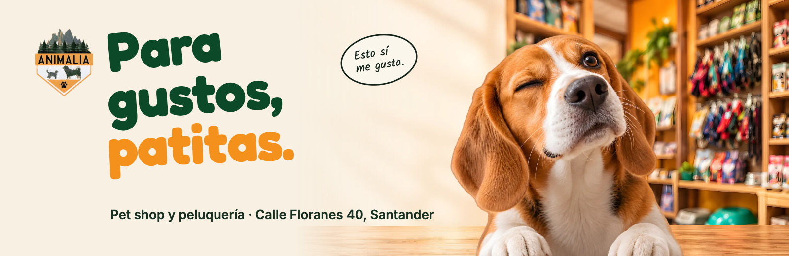
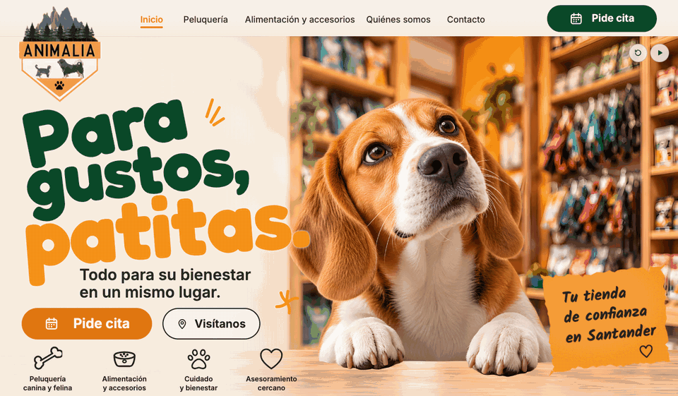
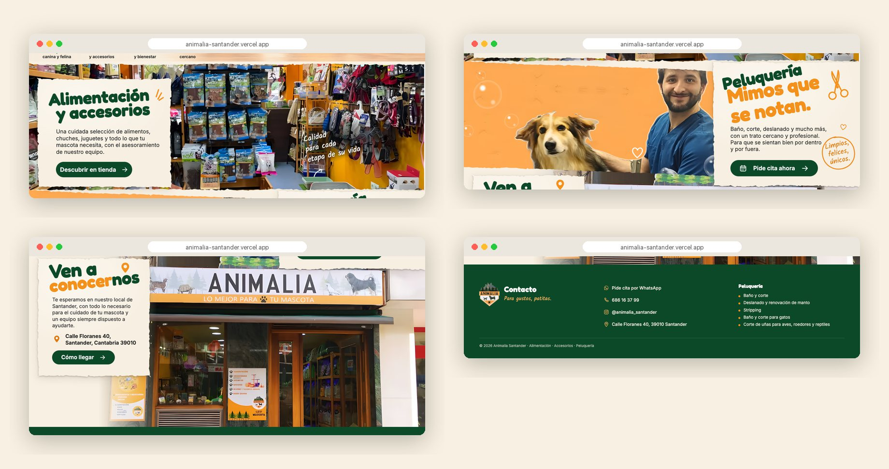
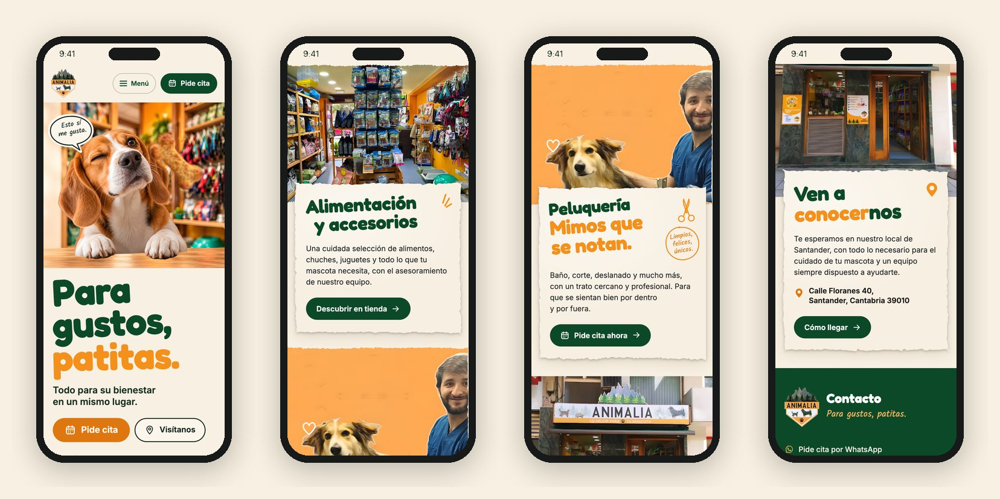

<div align="center">



<h3>A one-page website for a pet shop and grooming salon in Santander, built around a beagle who winks at a treat.</h3>

<p>
  <a href="https://animalia-santander.vercel.app"><strong>🌐 Live site</strong></a>
  &nbsp;·&nbsp;
  <a href="#hero-animation"><strong>🎬 How the hero works</strong></a>
  &nbsp;·&nbsp;
  <a href="#getting-started"><strong>🛠️ Run it locally</strong></a>
</p>

<p>
  <a href="https://animalia-santander.vercel.app"></a>
  
  
  
  
</p>

</div>

<br />

## 🚀 Overview

**Animalia** is a neighbourhood pet shop on Calle Floranes 40, Santander: food, treats, toys and accessories on the shelves, and a grooming salon for dogs, cats and small animals. The site follows the approved visual direction to the letter: cream paper, forest green and orange, a big hand-set headline and one curious beagle who follows a treat, winks and says *«Esto sí me gusta.»*

Below the hero, every section uses the shop's own pictures: the real shop floor, the grooming team's post and the real green-stone façade with its white sign.

- **A page that looks like the approved board**: on desktop every element sits at its measured board position, so the page and the mock-up overlap almost pixel for pixel
- **A small story, played once**: a 4.4 s entrance built from transparent 2D layers, with pause and replay controls, never looping
- **Straight to an appointment**: every *Pide cita* opens WhatsApp; phone, Instagram and directions are one tap away, and all of it is readable without JavaScript
- **Light**: 0.65 MB on a first phone visit and 0.75 MB on desktop, images in AVIF with WebP fallback

<br />

<a name="hero-animation"></a>

## 🎬 The hero animation

<div align="center">
  <a href="https://animalia-santander.vercel.app"></a>
  <sub>Plays once on load on the live site · captured at 1440 × 900</sub>
</div>

<br />

The entrance follows the kit's motion script (`06-roteiros/ANIMACAO.md`), once, without sound and without locking the scroll:

| Time      | What happens                                                                                       |
| :-------- | :------------------------------------------------------------------------------------------------- |
| 0–1.2 s   | The biscuit comes in from the right, near where the beagle is looking; nothing crosses the headline |
| 1.2–2.4 s | A short arc; the whole dog tilts a little around its paws (head, muzzle and paws are never deformed) |
| 2.4–3.2 s | Crossfade from the open-eyed pose to the wink, and the speech bubble pops in                        |
| 3.2–4.4 s | The biscuit settles exactly where the approved board shows it; the scene holds                      |

**Under the hood**

- 🧩 **Three transparent layers over an empty shop backdrop**: two beagle poses on an identical 1448 × 1086 canvas and one biscuit. The open pose stays opaque under the wink, so the dog never turns see-through during the crossfade.
- 📐 **Registered on the board, not eyeballed.** The beagle layer was fitted to the dog in the approved image with a similarity transform on five landmarks (both eyes, nose, both paws), and the biscuit by its length and angle. The headline lines were fitted to the board's ink by `scripts/fit-title.mjs` (size, angle and position per line, converging to under 1 px).
- 🎛️ **The CSS default is the last frame.** Without JavaScript, with `prefers-reduced-motion`, with `?static` or if a layer fails to load in 2.5 s, the page shows the board's frame straight away. A tiny inline script hides the treat and the wink before first paint and has a failsafe that reveals them if the bundle never runs.
- ⏯️ **Controls**: *Repetir animación* and *Pausar / Continuar animación* buttons, plus `?t=<ms>` to freeze any moment for screenshots and tests.

<br />

## 🖥️ Sections

<div align="center">
  
</div>

<br />

| #   | Section                                | Anchor        | Role                                                                                       |
| :-- | :------------------------------------- | :------------ | :----------------------------------------------------------------------------------------- |
| 01  | **Para gustos, patitas.**              | `#inicio`     | Beagle entrance, *Pide cita* (WhatsApp) and *Visítanos*, four things the shop offers      |
| 02  | **Alimentación y accesorios**          | `#tienda`     | The real shop floor full-bleed, cream paper with the copy, a hand-written note             |
| 03  | **Peluquería. Mimos que se notan.**    | `#peluqueria` | The grooming team's own picture, paper on the right, *Pide cita ahora*                    |
| 04  | **Ven a conocernos**                   | `#nosotros`   | Address, *Cómo llegar* and the real façade on Calle Floranes                               |
| 05  | Contact footer                         | `#contacto`   | WhatsApp, phone, Instagram, address and the full list of grooming services                 |

<br />

## 📱 Mobile first, motion optional

<div align="center">
  
</div>

<br />

- The hero keeps a band for the beagle at the top and puts the headline and buttons below it, as in the kit's mobile mock-up
- Papers take the full width and overlap the photo above them; notes never cover text (checked on the ink, not on boxes)
- Compact header with an accessible menu (Escape closes it) and *Pide cita* always visible
- Every touch target is at least 44 px; no horizontal scroll from 360 px up

<br />

## ✨ Highlights

- **🎯 Board-exact desktop**: positions, sizes and angles measured on the approved image and written in board pixels (`calc(<px> * var(--u))`), from 900 px to 1600 px wide
- **📸 Real shop identity**: the services post was cleaned of its text list and Instagram UI with the post's own wall texture; the list lives in the footer instead
- **🖼️ Image pipeline**: Real-ESRGAN ×4 on the kit's photos and layers (`npm run prepare-images`), then AVIF + WebP at four widths with versioned names (`npm run images`)
- **🧾 One data file**: address, phone, WhatsApp, Instagram and services come from `src/data/site.js` and are written into the HTML at build time
- **♿ Accessible**: one `h1` with real text, skip link, visible focus, labelled controls, `aria-current` on the section in view
- **🔎 Ready to share**: Open Graph image, `PetStore` structured data, favicons; kept out of search engines until launch
- **✅ Tested**: `npm run qa` runs 70 checks on the production build (overflow at nine widths, intro and controls, reduced motion, no JavaScript, blocked bundle, real clicks, phone menu, notes vs text, copy hygiene)

<br />

## 💻 Tech stack

| <br />Vite 6 | <br />JavaScript | <br />HTML5 | <br />CSS3 | <br />Python | <br />Vercel |
| :---: | :---: | :---: | :---: | :---: | :---: |

### Why this stack?

- **Vite + plain JavaScript**: a one-page shop site needs static HTML and about 6 kB of script, not a framework runtime
- **Web Animations API**: a short, seekable, pausable timeline without an animation library
- **Python (OpenCV, PyTorch)**: image registration, clean-up and super-resolution for the kit's assets
- **Self-hosted fonts**: Fredoka, Inter and Kalam through Fontsource, no third-party font requests
- **Vercel**: every push to `main` deploys automatically

<br />

## 🎨 Design system

| Token         | Value                                                                        | Use                                         |
| :------------ | :--------------------------------------------------------------------------- | :------------------------------------------ |
| Forest        |  | Headlines, buttons, footer                  |
| Orange        |  | *patitas.*, accents, sticker                |
| Button orange |  | *Pide cita* (white text keeps 3:1 contrast) |
| Cream         |  | Background and paper                        |
| Ink           |  | Outlines, icons, hand-written notes         |

- **Type**: Fredoka 700 for display (matched to the board's lettering), Inter for text and buttons, Kalam for hand-written notes
- **Grid**: the approved board is 1024 px wide; on desktop `--u = min(100vw, 1600px) / 1024` and everything is placed in board pixels
- **Paper**: torn edges are deterministic `clip-path` polygons generated at build time (`src/torn.js`), with a soft double drop shadow
- **Motion**: one 4.4 s entrance, papers settle in with 14 px and a fade; nothing loops

<br />

<a name="getting-started"></a>

## 🛠️ Getting started

```bash
# Clone the repository
git clone https://github.com/Jeanfr1/animaliawebsite.git
cd animaliawebsite

# Install dependencies (Node 20.10+)
npm install

# Start the dev server  →  http://localhost:5173
npm run dev

# Production build  →  dist/
npm run build

# Preview the production build  →  http://localhost:4197
npm run preview

# Checks against the preview (or QA_BASE=<url> npm run qa)
npm run qa
npm run compare      # page vs approved board at 1024 px → qa/compare-*.png

# Image masters from the kit (Real-ESRGAN, needs Python + PyTorch), then web images
npm run prepare-images
npm run images
```

<br />

## 📁 Project structure

```
animaliawebsite/
├── index.html                  # Every section: hero → tienda → peluquería → visita → contacto
├── src/
│   ├── main.js                 # Entry: fonts, styles, menu, active link, paper reveal
│   ├── hero.js                 # 4.4 s entrance (Web Animations), controls, ?static / ?t= flags
│   ├── styles.css              # Tokens, phone layout, board-exact desktop layout
│   ├── torn.js                 # Torn-paper clip-path polygons (build time)
│   └── data/site.js            # Address, phone, WhatsApp, Instagram, services
├── vite.config.js              # Build-time HTML: {{tokens}} from site.js, data-torn outlines
├── public/                     # img/ (AVIF + WebP, generated), og image, robots.txt
├── scripts/
│   ├── prepare-images.py       # Real-ESRGAN masters, services post clean-up → assets-src/
│   ├── build-images.mjs        # AVIF/WebP widths + favicons (sharp)
│   ├── fit-title.mjs           # Fits the headline lines to the board's ink
│   ├── board-compare.mjs       # Page vs board side by side, blend and diff
│   ├── qa.mjs                  # 70 checks on the production build
│   └── readme-assets.mjs       # Captures for this README (+ readme-composite.py)
└── 00-referencias … 09-verificacao/   # The original design kit (kept in the repo, never deployed)
```

<br />

## 🚀 Deployment

Hosted on **Vercel** and connected to this repository: every push to `main` ships to production.

**Live site:** [animalia-santander.vercel.app](https://animalia-santander.vercel.app)

| Setting          | Value           |
| :--------------- | :-------------- |
| Framework        | Vite            |
| Build command    | `npm run build` |
| Output directory | `dist`          |

The design kit folders are excluded from the deployment by `.vercelignore`. The site is `noindex` (meta tag, `X-Robots-Tag` header and `robots.txt`) until the shop approves it.

<br />

## 📌 Content checklist

Items waiting on the shop. Each one is marked `TODO(animalia)` in the code.

- [ ] Confirm phone, WhatsApp link and the list of grooming services (taken from the shop's screenshots)
- [ ] Sign-off on the hero imagery: the beagle, the biscuit and the shop backdrop are campaign art, not the shop's own photos
- [ ] Confirm the board wording used over the kit's copy file: *Asesoramiento cercano*, *Tu tienda de confianza en Santander*, *Calidad para cada etapa de su vida* and the shop and grooming paragraphs
- [ ] Permission for the groomer's picture, or an original photo of the grooming room
- [ ] Master logo file (the current one is traced from a screenshot)
- [ ] Google Maps place link for the shop (no place id was found; the link searches the name and full address)
- [ ] Opening hours and prices, if the shop wants them shown (none were supplied, so none are shown)
- [ ] Final domain, then update `canonical` / `og:url` and remove `noindex`

**Choices made where the kit disagreed with itself**

- The approved board shows a concept façade (orange, idealised); the page uses the **real** façade, as the direction notes ask
- The board's grooming photo is a concept; the page uses the shop's own services post, cleaned of its text list
- The board's *Ver productos* button became *Descubrir en tienda*: there is no online catalogue, as the section script says
- The board's headline was set as live text in Fredoka (fitted to the board) instead of the kit's traced SVG title, so it stays sharp and selectable
- *Quiénes somos* points to the visit section: the kit has no separate about section

<br />

## 🙏 Acknowledgments

- **Animalia Santander** for the brief, the photos and the approved visual direction
- **[Fredoka](https://fonts.google.com/specimen/Fredoka)**, **[Inter](https://rsms.me/inter/)** and **[Kalam](https://fonts.google.com/specimen/Kalam)** (OFL), via **[Fontsource](https://fontsource.org)**
- **[Real-ESRGAN](https://github.com/xinntao/Real-ESRGAN)** for the image upscaling
- **[Vite](https://vite.dev)** and **[Vercel](https://vercel.com)**

<br />

---

<div align="center">
  
  <p><strong>Para gustos, patitas.</strong></p>
  <p>Built with ❤️ by <a href="https://github.com/Jeanfr1">Jean</a> for Animalia Santander</p>
  <sub>© 2026 Animalia Santander. All rights reserved.</sub>
</div>
